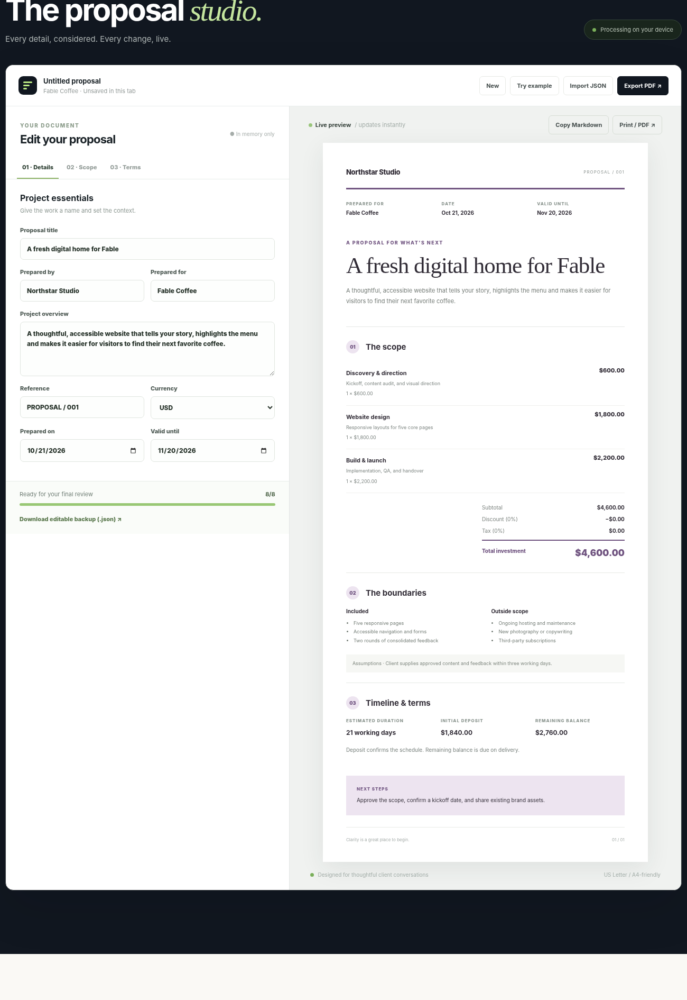

# Clariquote

**Make the work clear. Make it beautiful.**

Clariquote is a thoughtfully designed, local-first proposal and scope-of-work studio for freelancers, consultants, designers, developers, and independent teams.

No account. No watermark. No uploaded client documents. No external runtime dependencies.



*Product screenshot with fictional sample data.*

## Features

- **Live proposal studio:** update project details and see the client-ready document instantly.
- **Scope clarity:** record deliverables, inclusions, exclusions, assumptions, timelines, and next steps.
- **Transparent pricing:** line-item fees, quantities, discounts, tax, deposits, and balances.
- **Three document themes:** Plum, Forest, and Mono, including print-friendly layouts.
- **Client-ready exports:** Print / Save to PDF, copy Markdown, and export editable JSON backups.
- **Private by design:** proposal text lives in your browser tab. No storage, telemetry, external requests, or API keys.
- **Offline capable:** service worker caches the application shell after the first HTTPS visit.
- **Accessible foundation:** labeled inputs, keyboard interactions, responsive layout, reduced-motion support.

## Quick start

Requires Node.js 20 or newer. No external runtime dependencies.

```bash
npm ci --ignore-scripts
npm run dev
```

Open **http://127.0.0.1:4173**.

### Verify and build

```bash
npm run verify
```

Build artifacts are written to `dist/`. The checks cover calculations, import validation, Markdown export, basic HTTP security and public-release source hygiene.

## Deploy

This is a static website. Serve `dist/` from any HTTPS-capable static host. See [deployment guidance](docs/DEPLOYMENT.md) for Cloudflare Pages and GitHub Pages, and [the roadmap](docs/ROADMAP.md) for planned improvements.

## Important details

- The example named **Northstar Studio / Fable Coffee** is entirely fictional. Select **New** for a blank proposal.
- Browser **Print / PDF** opens the platform print dialog; choose Save as PDF. Pagination depends on the browser and should be reviewed before sending.
- Import/export JSON is editable and unencrypted. Do not publish proposals containing confidential customer information in public issues.
- There is no server-side sync, invoice delivery, payment processing, legal advice, digital signature, or automatic contractual acceptance.
- Figures are calculations, not jurisdiction-specific tax advice. Check accuracy, scope, legal requirements and local taxes before sending.
- The app does not save customer data to localStorage; closing the tab clears unsaved changes. Use **Download editable backup** when you want to continue later.
- A static hosting provider can still receive ordinary connection metadata (for example IP addresses when a page is requested), but the app does not transmit proposal contents.

## Contributing

Bug reports and pull requests are welcome. Read [CONTRIBUTING.md](CONTRIBUTING.md) and [SECURITY.md](SECURITY.md) first. Please use only fictional demo data in issues and screenshots.

## License

MIT — see [LICENSE](LICENSE).
